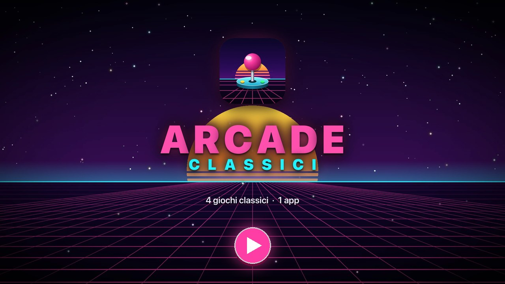

<p align="center"></p>

<h1 align="center">Arcade Classici</h1>

<p align="center">Quattro giochi classici rivisitati in chiave neon/synthwave e 3D, per Android.</p>

<p align="center"><a href="../../releases/latest"><b>⬇ Scarica l'ultima versione (APK)</b></a></p>

<p align="center">
  <a href="docs/trailer.mp4"></a><br>
  <sub>▶ Guarda il video di presentazione (53 s, musica originale)</sub>
</p>

## Giochi
- **Snake** – movimento fluido, bordi attraversabili, stella bonus
- **Campo Minato** – tre difficoltà, prima mossa sicura, apertura rapida sui numeri
- **Breakout** – sei livelli, mattoni resistenti e d'acciaio, potenziamenti e combo
- **Invasori** – in stile Space Invaders: alieni voxel, scudi distruttibili, UFO e potenziamenti

Ogni gioco ha un tutorial illustrato, musica propria ed effetti sonori sintetizzati in tempo reale.
L'app si aggiorna da sola: in **Impostazioni → Aggiornamenti** controlla l'ultima release di questo repository.

## Tecnologie
- Kotlin + Jetpack Compose, rendering su Canvas
- Grafica interamente disegnata in codice (nessuna immagine esterna)
- Effetti sonori e musiche chiptune generati dall'app (`audio/`)

## Struttura
| Cartella | Contenuto |
| --- | --- |
| `audio/` | sintetizzatore effetti, sequencer musicale, brani |
| `ui/` | tema neon, componenti 3D, icone, sfondi, particelle, tutorial |
| `menu/` | menu principale con anteprime animate |
| `update/` | controllo e installazione aggiornamenti da GitHub |
| `games/*` | logica, disegno, schermata e tutorial di ogni gioco |

## Compilare
Richiede JDK 17+ (va bene quello di Android Studio) e Android SDK 36.
```bash
./gradlew :app:assembleRelease
```
Senza `keystore.properties` la build release viene firmata con la chiave di debug.

## Pubblicare una release
```bash
scripts/release.sh            # incrementa la patch (1.0.0 → 1.0.1)
scripts/release.sh minor      # 1.0.1 → 1.1.0
scripts/release.sh 2.0.0      # versione esplicita
```
Lo script aggiorna la versione, compila l'APK firmato, crea il commit e il tag, pubblica la nuova release
su GitHub con l'APK allegato ed elimina le release precedenti.

## Licenza
[MIT](LICENSE)
